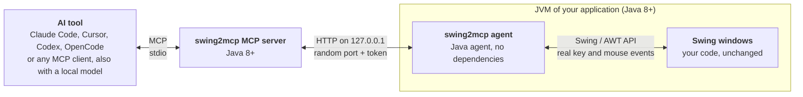
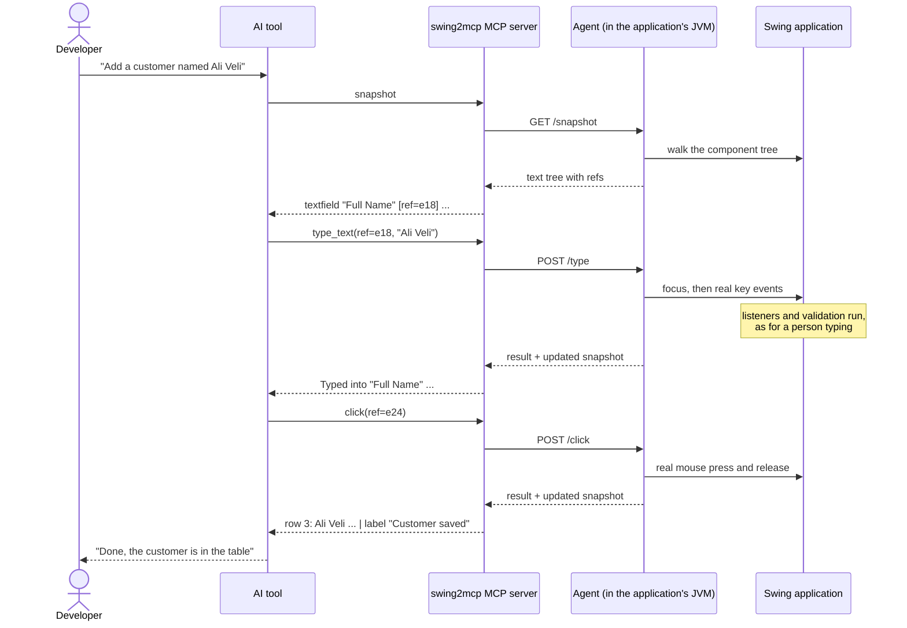

# swing2mcp

A developer tool that lets AI tools **see and use** legacy Java Swing applications without
touching their code. It offers a Playwright-like experience for Swing.
It works with Claude Code, Cursor, OpenCode, Codex and any tool that supports MCP.

> **Early release (0.x).** swing2mcp works and is covered by tests, but tool names and options may still
> change before 1.0. Releases are on Maven Central and on the
> [GitHub releases page](https://github.com/ibrahimcavdar/swing2mcp/releases).

## Quick start (Maven project)

**1. Add the plugin to your project's `pom.xml`.** This is the only part you need to add:

```xml
<build>
  <plugins>
    <plugin>
      <groupId>io.github.ibrahimcavdar</groupId>
      <artifactId>swing2mcp-maven-plugin</artifactId>
      <version>0.1.0</version>
    </plugin>
  </plugins>
</build>
```

**2. Connect your AI tool.** Once per machine:

```bash
mvn swing2mcp:setup
```

The command asks which of your AI tools to connect (Claude Code, Cursor, Codex, OpenCode), lists the
changes it is about to make, and waits for your yes. It then:

- copies the MCP server to `~/.swing2mcp/bin`
- adds one entry named `swing` to the MCP settings of the tools you picked

Nothing else on your machine changes, and nothing is added to your project.
`mvn swing2mcp:uninstall` removes all of it again. For other MCP clients, or to do it by hand, see
[Connecting an AI tool by hand](#connecting-an-ai-tool-by-hand).

**3. Start your application with swing2mcp**, instead of your usual way:

```bash
mvn swing2mcp:run
```

It compiles the project and starts your application in its own Java process, with the swing2mcp agent
loaded into it. The application behaves as always; the agent is what lets the AI tool see and use it.
Close the application or press Ctrl+C, and both stop. Nothing is written into your jar or your code.

Main class not found? Add `-Dswing2mcp.mainClass=com.example.Main`. Application already open? See
[Connecting to an application that is already open](#connecting-to-an-application-that-is-already-open).

**4. Tell the AI tool what you want it to do**, for example: *"Log in with admin/admin,
add a customer named Ali Veli from İzmir and check that it shows up in the table."* That prompt works
as it is on the [demo application](demo-app/README.md).

### Connecting to an application that is already open

Even if the application was opened without swing2mcp (from the IDE, with `java -jar`, with a `.bat` script), the AI
tool can connect to it later: just say *"connect to the open application"*. `list_apps`
shows the Java applications on the machine. `connect_app` places the agent inside the application
without a restart; the logged-in session and open screens are kept. `setup` is enough for this;
you do not even need to add the plugin to the pom.

### Seeing code changes without a restart (hot reload)

The AI tool changes the source code, compiles it (`mvn -q compile` or the IDE) and with `hot_reload` applies the change
to the running application. The application does not close and the logged-in session is kept:

- If only button behavior, business logic or painting code changed, the open screens stay as they are
  (including typed text and selections).
- If a screen's setup code changed (constructor, `initComponents`, `@PostConstruct`...), only that
  screen is rebuilt.
- Adding a new method/field or a new lambda requires a restart on a standard JVM; the tool says so clearly
  without applying anything.

Only classes whose code really changed are reloaded, even when the build rewrote every class file.

**Multi-module projects:** when the application is started from one module (e.g. the one with the main
class), the other modules come from their jars in `~/.m2`. Put their compiled classes first on the
classpath, and `hot_reload` picks up changes in those modules too:

```
mvn swing2mcp:run -Dswing2mcp.classesDirs=../core/target/classes,../ui/target/classes
```

Without it, or if the application runs from a jar, pass the folder of the compiled classes instead:
`classesDir=../core/target/classes`. The classes as they were loaded are read from the jar, so the result is the
same: only the changed classes are reloaded.

### Spring applications

No extra setting is needed. If the application uses Spring, swing2mcp finds the Spring context itself
without touching the application. The AI tool can list screens and services with `spring_beans`, and
open a screen directly with `open_spring_bean`, without navigating the menus (*"open the Settings
screen"*). In applications without Spring these two tools just say "Spring not found"; everything else
works the same.

### `swing2mcp:run` options

| Property | Description |
|---|---|
| `-Dswing2mcp.mainClass=...` | Main class. If not given, it is taken from the jar/assembly/exec plugin settings. |
| `-Dswing2mcp.jar=target/app.jar` | Runs a prebuilt jar instead of the project classpath. |
| `-Dswing2mcp.javaHome=/jdk8` | Runs the application with a different Java (e.g. Maven on 17, the application on 8). |
| `-Dswing2mcp.jvmArgs="-Xmx1g -Dprofile=dev"` | Extra JVM options. |
| `-Dswing2mcp.args="..."` | Application arguments. |
| `-Dswing2mcp.classesDirs=../core/target/classes,...` | Class folders of other modules, put before the jars (multi-module hot reload). |
| `-Dswing2mcp.agent=false` | Runs plainly, without the agent. |

### Connecting an AI tool by hand

`mvn swing2mcp:setup` only saves typing. Everything it sets up is one MCP server entry that starts a jar
with Java (8 or newer):

```json
{
  "mcpServers": {
    "swing": {
      "command": "/path/to/java",
      "args": ["-jar", "/home/you/.swing2mcp/bin/swing2mcp-0.1.0.jar"]
    }
  }
}
```

Both paths must be absolute. To get the jar without changing any tool's settings, run
`mvn swing2mcp:setup` and answer `0`; the last lines of its output show the two paths for your machine.

<details>
<summary>Claude Code</summary>

For all your projects:

```bash
claude mcp add --scope user swing -- /path/to/java -jar /home/you/.swing2mcp/bin/swing2mcp-0.1.0.jar
```

For one project only, put the entry above into `.mcp.json` in the project folder.

</details>

<details>
<summary>Cursor</summary>

Put the entry above into `~/.cursor/mcp.json` (all projects) or `.cursor/mcp.json` in the project folder.

</details>

<details>
<summary>Codex</summary>

Add to `~/.codex/config.toml`:

```toml
[mcp_servers.swing]
command = "/path/to/java"
args = ["-jar", "/home/you/.swing2mcp/bin/swing2mcp-0.1.0.jar"]
```

</details>

<details>
<summary>OpenCode</summary>

Add to `~/.config/opencode/opencode.json` (all projects) or `opencode.json` in the project folder:

```json
{
  "mcp": {
    "swing": {
      "type": "local",
      "command": ["/path/to/java", "-jar", "/home/you/.swing2mcp/bin/swing2mcp-0.1.0.jar"],
      "enabled": true
    }
  }
}
```

</details>

<details>
<summary>Other MCP clients and local models</summary>

Any client that can start a local (stdio) MCP server works: give it the command
`/path/to/java -jar /home/you/.swing2mcp/bin/swing2mcp-0.1.0.jar`. The server needs no API
key and connects to nothing outside your machine.

</details>

`setup` also takes its answers as options, for scripts: `-Dswing2mcp.clients=claude,cursor` names the
tools, and `-Dswing2mcp.scope=project` writes the settings into the project folder instead of your user
settings (those files then hold paths of your machine, so do not commit them).

### Requirements

- Java 8 or newer, for everything: your application, Maven and the MCP server. Tested with Java 8, 21
  and 25. One Java is enough; they do not have to be the same.
- Maven 3.6.3 or newer.
- Connecting to an application that is already open (`connect_app`) needs the MCP server to run on a
  JDK, not a JRE.

## What the AI tool can use

| Tool | Description |
|---|---|
| `list_apps` / `connect_app` | Lists running Java applications / connects to one; if it has no agent, places it without a restart |
| `snapshot` | Text summary of the windows, with `ref` IDs |
| `screenshot` | PNG image of a window or component |
| `click` | Real mouse click on a button, table cell, list item or tree node (by text or path); double click, right click, column header, with Ctrl/Shift |
| `type_text` | Types real keys into a text field, password, spinner or editable combo |
| `press_key` | Enter, Escape, Tab, arrows, F-keys and shortcuts such as Ctrl+S |
| `select_option` | Combo, list, tab, table cell, tree node (by path); several rows, items or nodes with Ctrl/Shift clicks, ranges included |
| `drag` | Mouse drag (pan a map, move a slider, a split pane divider, a table column) and drag and drop between components |
| `read_items` | Reads tables, lists, trees and combos page by page, as they are shown |
| `expand_node` | Expands or collapses a tree node by its path |
| `select_menu` | Chooses a menu path such as "File > Open", also in context menus |
| `handle_dialog` | Answers a message box, input dialog or file chooser |
| `wait_for` | Waits for a text to appear or disappear |
| `hot_reload` | Applies compiled code changes without a restart; rebuilds the screen if needed |
| `spring_beans` | Lists the beans in Spring applications (screens are shown separately) |
| `open_spring_bean` | Opens a Spring screen bean directly, without navigating the menu |
| `launch_app` / `stop_app` | The AI tool starting / closing the application itself (use outside Maven) |

Example snapshot:

```
- frame "ACME Customer Manager 3.2 - admin" [ref=e10] 900x620 active class=MainFrame
  - menubar [ref=e11]
    - menu "File" [ref=e12] items=3 (closed)
  - tabs [ref=e15] tabs=["Customers"(selected), "Orders", "Reports"] field=tabs
    - panel CustomerPanel [ref=e16] field=customerPanel
      - group "Customer Details" [ref=e17]
        - textfield "Full Name" [ref=e18] value="" field=txtName
        - combobox "City" [ref=e20] value="Ankara" options=["Ankara", "İstanbul", ...] field=cmbCity
        - button "Save" [ref=e23] field=btnSave
      - table [ref=e26] rows=3 cols=5 field=tblCustomers
        - columns: ID | Full Name | Email | City | Active
        - row 0: 1 | Ayşe Yılmaz | ayse@example.com | Ankara | [x]
```

`field=` is the name of the Java field that holds the component in the application; it makes matching the screen with the code easier.

Actions work **like a real user**, so the application runs the same code as for a person: `type_text` and
`press_key` send real key events (key listeners, input verifiers, length limits and shortcuts run),
`click` sends real mouse events (the focus moves first, as with a mouse), and menus open level by level.
The application window does not have to be in front: keys go to the application, not to the program you
are typing in. `drag` pans and moves with in-application mouse events, and does drag and drop through the
application's own TransferHandlers (its `canImport`, `importData` and `exportDone` run, at a real drop
location), without the operating system's drag and drop; `mode=os` uses the real mouse when that is
needed. An action that opens a dialog can answer it right away, e.g. `click` on Delete with
`dialog=yes`; the result repeats the dialog's message.

Actions first wait until the component can take input: visible,
enabled, editable, not blocked by a modal dialog or a busy overlay (up to `timeoutMs`, default 10 s). If
the application throws an exception that it does not handle, during the action or since the last call,
the tool result says so, with the stack trace, so the AI tool notices that its change broke something.

## How does it work?



Everything runs on your machine. The AI tool starts the MCP server as a local process and talks to it
over stdio. The agent lives inside the application's JVM, so it reads the screen as text from the
component tree instead of from pixels, and it works while the window is in the background.

The agent gets into the application in one of three ways, always on an explicit request:

| How | Who starts it |
|---|---|
| `mvn swing2mcp:run` | You start the application from Maven, with the agent |
| `launch_app` | The AI tool starts the application with a command you would use yourself |
| `connect_app` | The AI tool attaches to an application that is already running |

The agent listens only on `127.0.0.1`, with a random port and token. It writes the connection details to
`~/.swing2mcp/jvms/<pid>.properties` (readable only by its owner) and deletes the file when the
application exits.

What happens when you ask for something:



Why it is built this way: [docs/design.md](docs/design.md).

## Contributing

`mvn install` with JDK 17+ builds everything and runs the tests.
The rules of the code base, testing and releases are in [CONTRIBUTING.md](CONTRIBUTING.md); changes
between versions are in [CHANGELOG.md](CHANGELOG.md). Security model and how to report a vulnerability:
[SECURITY.md](SECURITY.md).

## License

Created and maintained by [Halil İbrahim Çavdar](https://github.com/ibrahimcavdar).
Licensed under the [Apache License 2.0](LICENSE).
