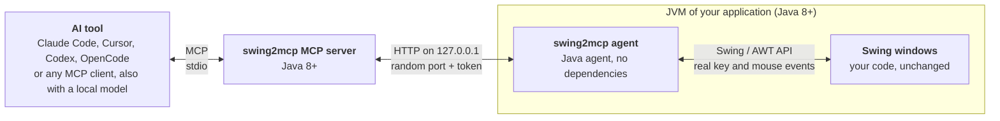

# swing2mcp

[](https://glama.ai/mcp/servers/ibrahimcavdar/swing2mcp)

swing2mcp lets AI coding tools **see and use** legacy Java Swing applications, without touching their
code.

On the web, an AI tool can open the page and check its own work, with tools such as Playwright. For
Swing applications that loop is usually missing: the AI tool writes code that it cannot try. swing2mcp
closes the loop. The AI tool reads the screen as text, clicks and types like a user, and sees the
result of a code change without a restart.

It works with Claude Code, Cursor, Codex, OpenCode and any tool that supports MCP, also with a local
model.

> **Early release (0.x).** swing2mcp works and is covered by tests, but tool names and options may still
> change before 1.0. Releases are on Maven Central and on the
> [GitHub releases page](https://github.com/ibrahimcavdar/swing2mcp/releases).



swing2mcp runs on your machine and sends nothing off it. What the AI tool does with the screen content
it reads depends on the AI tool and the model you connect; with a local model, nothing leaves the
machine.

## Quick start (Maven project)

**1. Add the plugin to your project's `pom.xml`.** This is the only part you need to add:

```xml
<build>
  <plugins>
    <plugin>
      <groupId>io.github.ibrahimcavdar</groupId>
      <artifactId>swing2mcp-maven-plugin</artifactId>
      <version>0.1.0</version>
    </plugin>
  </plugins>
</build>
```

**2. Connect your AI tool.** Once per machine:

```bash
mvn swing2mcp:setup
```

The command asks which of your AI tools to connect (Claude Code, Cursor, Codex, OpenCode), lists the
changes it is about to make, and waits for your yes. It then:

- copies the MCP server to `~/.swing2mcp/bin`
- adds one entry named `swing` to the MCP settings of the tools you picked

Nothing else on your machine changes, and nothing is added to your project.
`mvn swing2mcp:uninstall` removes all of it again. For other MCP clients, or to do it by hand, see
[Connecting an AI tool by hand](docs/usage.md#connecting-an-ai-tool-by-hand).

**3. Start your application with swing2mcp**, instead of your usual way:

```bash
mvn swing2mcp:run
```

It compiles the project and starts your application in its own Java process, with the swing2mcp agent
loaded into it. The application behaves as always; the agent is what lets the AI tool see and use it.
Close the application or press Ctrl+C, and both stop. Nothing is written into your jar or your code.

Main class not found? Add `-Dswing2mcp.mainClass=com.example.Main`. Application already open? See
[Connecting to an application that is already open](docs/usage.md#connecting-to-an-application-that-is-already-open).

**4. Tell the AI tool what you want it to do**, for example: *"Log in with admin/admin,
add a customer named Ali Veli from İzmir and check that it shows up in the table."* That prompt works
as it is on the [demo application](demo-app/README.md).

### Requirements

- Java 8 or newer, for everything: your application, Maven and the MCP server. Tested with Java 8, 21
  and 25. One Java is enough; they do not have to be the same.
- Maven 3.6.3 or newer.

## Beyond the quick start

- **An application that is already open.** Say *"connect to the open application"*: the AI tool
  attaches without a restart, and the logged-in session and open screens are kept.
  [More](docs/usage.md#connecting-to-an-application-that-is-already-open)
- **Hot reload.** The AI tool changes the code, compiles it and applies the change to the running
  application, without a restart.
  [More](docs/usage.md#seeing-code-changes-without-a-restart-hot-reload)
- **Spring.** In Spring applications the AI tool can list the screens and open one directly, with no
  extra setting. [More](docs/usage.md#spring-applications)
- **Options and other setups.** [`swing2mcp:run` options](docs/usage.md#swing2mcprun-options),
  [connecting an AI tool by hand](docs/usage.md#connecting-an-ai-tool-by-hand).

## What the AI tool can use

| Tool | Description |
|---|---|
| `list_apps` / `connect_app` | Lists running Java applications / connects to one; if it has no agent, places it without a restart |
| `snapshot` | Text summary of the windows, with `ref` IDs |
| `screenshot` | PNG image of a window or component |
| `click` | Real mouse click on a button, table cell, list item or tree node (by text or path); double click, right click, column header, with Ctrl/Shift |
| `type_text` | Types real keys into a text field, password, spinner or editable combo |
| `press_key` | Enter, Escape, Tab, arrows, F-keys and shortcuts such as Ctrl+S |
| `select_option` | Combo, list, tab, table cell, tree node (by path); several rows, items or nodes with Ctrl/Shift clicks, ranges included |
| `drag` | Mouse drag (pan a map, move a slider, a split pane divider, a table column) and drag and drop between components |
| `read_items` | Reads tables, lists, trees and combos page by page, as they are shown |
| `expand_node` | Expands or collapses a tree node by its path |
| `select_menu` | Chooses a menu path such as "File > Open", also in context menus |
| `handle_dialog` | Answers a message box, input dialog or file chooser |
| `wait_for` | Waits for a text to appear or disappear |
| `hot_reload` | Applies compiled code changes without a restart; rebuilds the screen if needed |
| `spring_beans` | Lists the beans in Spring applications (screens are shown separately) |
| `open_spring_bean` | Opens a Spring screen bean directly, without navigating the menu |
| `launch_app` / `stop_app` | Starts / closes the application from the AI tool, for projects without Maven |

Example snapshot:

```
- frame "ACME Customer Manager 3.2 - admin" [ref=e10] 900x620 active class=MainFrame
  - menubar [ref=e11]
    - menu "File" [ref=e12] items=3 (closed)
  - tabs [ref=e15] tabs=["Customers"(selected), "Orders", "Reports"] field=tabs
    - panel CustomerPanel [ref=e16] field=customerPanel
      - group "Customer Details" [ref=e17]
        - textfield "Full Name" [ref=e18] value="" field=txtName
        - combobox "City" [ref=e20] value="Ankara" options=["Ankara", "İstanbul", ...] field=cmbCity
        - button "Save" [ref=e23] field=btnSave
      - table [ref=e26] rows=3 cols=5 field=tblCustomers
        - columns: ID | Full Name | Email | City | Active
        - row 0: 1 | Ayşe Yılmaz | ayse@example.com | Ankara | [x]
```

`field=` is the name of the Java field that holds the component in the application; it makes matching the screen with the code easier.

Actions work like a real user: real key and mouse events, so the application's listeners and validation
run, and the window does not have to be in front. Details: [How actions behave](docs/usage.md#how-actions-behave).

## How does it work?

The AI tool starts the MCP server as a local process and talks to it over stdio. The agent lives inside
the application's JVM, so it reads the screen as text from the component tree instead of from pixels,
and it works while the window is in the background.

The agent gets into the application in one of three ways, always on an explicit request:

| How | Who starts it |
|---|---|
| `mvn swing2mcp:run` | You start the application from Maven, with the agent |
| `launch_app` | The AI tool starts the application with a command you would use yourself |
| `connect_app` | The AI tool attaches to an application that is already running |

The agent listens only on `127.0.0.1`, with a random port and token. More on this in
[SECURITY.md](SECURITY.md); a request step by step in [docs/usage.md](docs/usage.md#how-a-request-travels);
why it is built this way in [docs/design.md](docs/design.md).

## Contributing

`mvn install` with JDK 17+ builds everything and runs the tests.
The rules of the code base, testing and releases are in [CONTRIBUTING.md](CONTRIBUTING.md); changes
between versions are in [CHANGELOG.md](CHANGELOG.md). Security model and how to report a vulnerability:
[SECURITY.md](SECURITY.md).

## License

Created and maintained by [Halil İbrahim Çavdar](https://github.com/ibrahimcavdar).
Licensed under the [Apache License 2.0](LICENSE).
