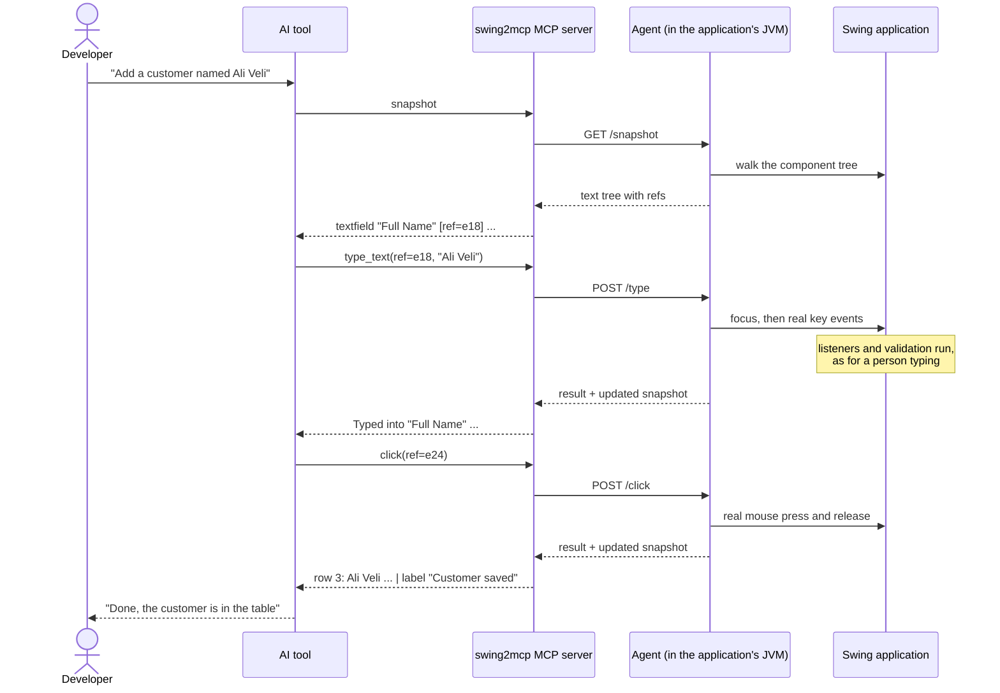

# Using swing2mcp

Everything beyond the [quick start](../README.md#quick-start-maven-project).

- [Connecting to an application that is already open](#connecting-to-an-application-that-is-already-open)
- [Seeing code changes without a restart (hot reload)](#seeing-code-changes-without-a-restart-hot-reload)
- [Spring applications](#spring-applications)
- [`swing2mcp:run` options](#swing2mcprun-options)
- [Connecting an AI tool by hand](#connecting-an-ai-tool-by-hand)
- [How actions behave](#how-actions-behave)
- [How a request travels](#how-a-request-travels)

## Connecting to an application that is already open

Even if the application was opened without swing2mcp (from the IDE, with `java -jar`, with a `.bat` script), the AI
tool can connect to it later: just say *"connect to the open application"*. `list_apps`
shows the Java applications on the machine. `connect_app` places the agent inside the application
without a restart; the logged-in session and open screens are kept. `setup` is enough for this;
you do not even need to add the plugin to the pom.

For this, the MCP server has to run on a JDK, not a JRE.

## Seeing code changes without a restart (hot reload)

The AI tool changes the source code, compiles it (`mvn -q compile` or the IDE) and with `hot_reload` applies the change
to the running application. The application does not close and the logged-in session is kept:

- If only button behavior, business logic or painting code changed, the open screens stay as they are
  (including typed text and selections).
- If a screen's setup code changed (constructor, `initComponents`, `@PostConstruct`...), only that
  screen is rebuilt.
- Adding a new method/field or a new lambda requires a restart on a standard JVM; the tool says so clearly
  without applying anything.

Only classes whose code really changed are reloaded, even when the build rewrote every class file.

**Multi-module projects:** when the application is started from one module (e.g. the one with the main
class), the other modules come from their jars in `~/.m2`. Put their compiled classes first on the
classpath, and `hot_reload` picks up changes in those modules too:

```
mvn swing2mcp:run -Dswing2mcp.classesDirs=../core/target/classes,../ui/target/classes
```

Without it, or if the application runs from a jar, pass the folder of the compiled classes instead:
`classesDir=../core/target/classes`. The classes as they were loaded are read from the jar, so the result is the
same: only the changed classes are reloaded.

## Spring applications

No extra setting is needed. If the application uses Spring, swing2mcp finds the Spring context itself
without touching the application. The AI tool can list screens and services with `spring_beans`, and
open a screen directly with `open_spring_bean`, without navigating the menus (*"open the Settings
screen"*). In applications without Spring these two tools just say "Spring not found"; everything else
works the same.

## `swing2mcp:run` options

| Property | Description |
|---|---|
| `-Dswing2mcp.mainClass=...` | Main class. If not given, it is taken from the jar/assembly/exec plugin settings. |
| `-Dswing2mcp.jar=target/app.jar` | Runs a prebuilt jar instead of the project classpath. |
| `-Dswing2mcp.javaHome=/jdk8` | Runs the application with a different Java (e.g. Maven on 17, the application on 8). |
| `-Dswing2mcp.jvmArgs="-Xmx1g -Dprofile=dev"` | Extra JVM options. |
| `-Dswing2mcp.args="..."` | Application arguments. |
| `-Dswing2mcp.classesDirs=../core/target/classes,...` | Class folders of other modules, put before the jars (multi-module hot reload). |
| `-Dswing2mcp.agent=false` | Runs plainly, without the agent. |

## Connecting an AI tool by hand

`mvn swing2mcp:setup` only saves typing. Everything it sets up is one MCP server entry that starts a jar
with Java (8 or newer):

```json
{
  "mcpServers": {
    "swing": {
      "command": "/path/to/java",
      "args": ["-jar", "/home/you/.swing2mcp/bin/swing2mcp-0.1.0.jar"]
    }
  }
}
```

Both paths must be absolute. To get the jar without changing any tool's settings, run
`mvn swing2mcp:setup` and answer `0`; the last lines of its output show the two paths for your machine.

<details>
<summary>Claude Code</summary>

For all your projects:

```bash
claude mcp add --scope user swing -- /path/to/java -jar /home/you/.swing2mcp/bin/swing2mcp-0.1.0.jar
```

For one project only, put the entry above into `.mcp.json` in the project folder.

</details>

<details>
<summary>Cursor</summary>

Put the entry above into `~/.cursor/mcp.json` (all projects) or `.cursor/mcp.json` in the project folder.

</details>

<details>
<summary>Codex</summary>

Add to `~/.codex/config.toml`:

```toml
[mcp_servers.swing]
command = "/path/to/java"
args = ["-jar", "/home/you/.swing2mcp/bin/swing2mcp-0.1.0.jar"]
```

</details>

<details>
<summary>OpenCode</summary>

Add to `~/.config/opencode/opencode.json` (all projects) or `opencode.json` in the project folder:

```json
{
  "mcp": {
    "swing": {
      "type": "local",
      "command": ["/path/to/java", "-jar", "/home/you/.swing2mcp/bin/swing2mcp-0.1.0.jar"],
      "enabled": true
    }
  }
}
```

</details>

<details>
<summary>Other MCP clients and local models</summary>

Any client that can start a local (stdio) MCP server works: give it the command
`/path/to/java -jar /home/you/.swing2mcp/bin/swing2mcp-0.1.0.jar`. The server needs no API
key and connects to nothing outside your machine.

</details>

`setup` also takes its answers as options, for scripts: `-Dswing2mcp.clients=claude,cursor` names the
tools, and `-Dswing2mcp.scope=project` writes the settings into the project folder instead of your user
settings (those files then hold paths of your machine, so do not commit them). `-Dswing2mcp.skill=true`
also adds the skill for [writing tests](testing.md) to the named tools.

## How actions behave

Actions work **like a real user**, so the application runs the same code as for a person: `type_text` and
`press_key` send real key events (key listeners, input verifiers, length limits and shortcuts run),
`click` sends real mouse events (the focus moves first, as with a mouse), and menus open level by level.
The application window does not have to be in front: keys go to the application, not to the program you
are typing in. `drag` pans and moves with in-application mouse events, and does drag and drop through the
application's own TransferHandlers (its `canImport`, `importData` and `exportDone` run, at a real drop
location), without the operating system's drag and drop; `mode=os` uses the real mouse when that is
needed. An action that opens a dialog can answer it right away, e.g. `click` on Delete with
`dialog=yes`; the result repeats the dialog's message.

Actions first wait until the component can take input: visible,
enabled, editable, not blocked by a modal dialog or a busy overlay (up to `timeoutMs`, default 10 s). If
the application throws an exception that it does not handle, during the action or since the last call,
the tool result says so, with the stack trace, so the AI tool notices that its change broke something.

## How a request travels



Why it is built this way: [design.md](design.md).
